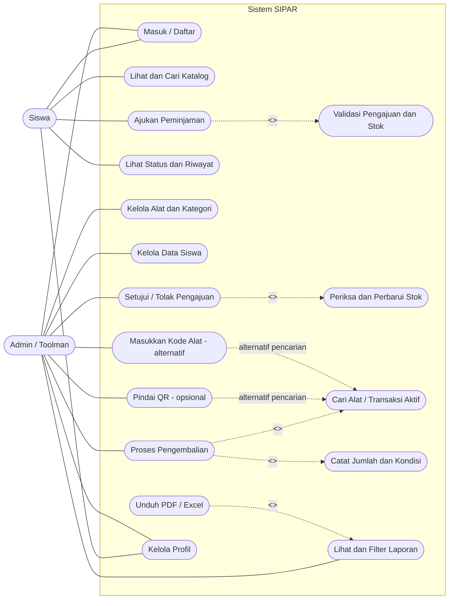
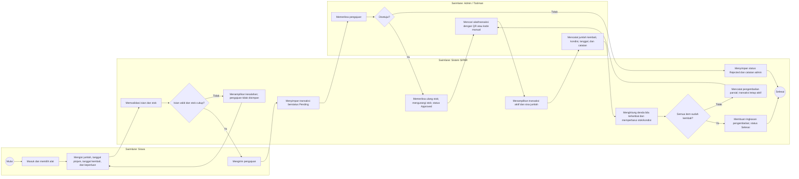
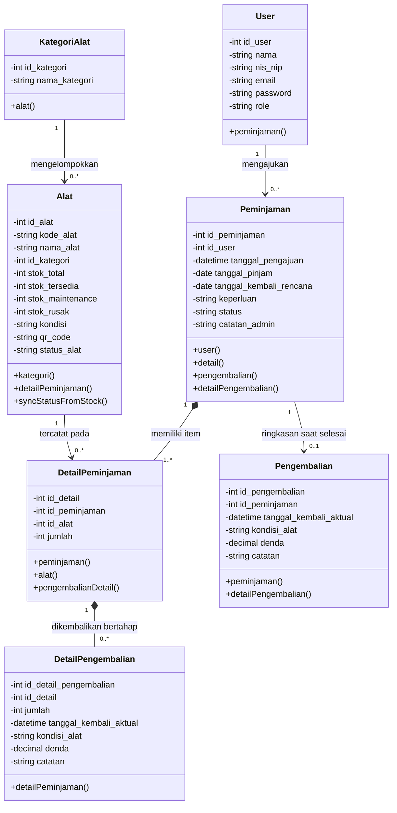

# Jawaban LKPD Pemrograman Teks, Grafik, dan Multimedia

## Analisis Permodelan UML dan Perancangan Elemen Multimedia Interaktif

### Identitas Kelompok

- **Nama kelompok:** ........................................................
- **Kelas / semester:** .....................................................
- **Anggota:** ................................................................
- **Tanggal pelaksanaan:** .................................................

> Dokumen ini disusun untuk proyek **SIPAR (Sistem Informasi Peminjaman Alat RPL SMK Negeri 5 Surakarta)**. Alur dan data utama mengikuti aplikasi SIPAR pada proyek. Rancangan multimedia yang belum tersedia di aplikasi ditandai sebagai usulan, bukan sebagai fitur yang sudah berjalan.

---

## BAGIAN A — PILIHAN TOPIK PROYEK MULTIMEDIA

### Topik yang dipilih

**Proyek 1: Sistem Peminjaman Alat / Inventaris**

### Fokus proyek

SIPAR membantu pengelolaan inventaris alat praktik RPL, pengajuan peminjaman oleh siswa, persetujuan oleh admin/toolman, pencatatan pengembalian alat, pemantauan stok dan kondisi alat, serta pembuatan laporan transaksi.

### Arah pengembangan: pemindai QR opsional

Sesuai arah pengembangan SIPAR, pemindaian QR membantu menemukan alat atau transaksi pengembalian, tetapi penggunaannya tidak wajib. Pada proyek saat ini pemindai dapat diaktifkan melalui konfigurasi `ENABLE_QR_SCANNER`; apabila dinonaktifkan, pencarian kode alat manual tetap tersedia. Dengan demikian, proses tetap dapat dilakukan tanpa kamera.

---

## BAGIAN B — LEMBAR KERJA 1: USE CASE DIAGRAM

### Hasil analisis kebutuhan sistem

#### Aktor utama

1. **Siswa** — melihat katalog dan stok alat, mengajukan peminjaman, serta memantau status dan riwayat peminjaman.
2. **Admin / Toolman** — mengelola data inventaris dan siswa, memproses persetujuan, mencatat pengembalian, serta melihat dan mengunduh laporan.

#### Daftar use case

| Aktor | Use case utama |
|---|---|
| Siswa | Masuk/daftar, melihat dan mencari katalog alat, melihat ketersediaan stok, mengajukan peminjaman, melihat status dan riwayat, mengelola profil |
| Admin / Toolman | Masuk, mengelola alat dan kategori, mengelola data siswa, melihat pengajuan, menyetujui atau menolak pengajuan, memproses pengembalian, mencatat kondisi alat, melihat dan memfilter laporan, mengekspor laporan PDF/Excel |

#### Relasi khusus

- **Ajukan peminjaman** `<<include>>` **Validasi data pengajuan dan ketersediaan stok**, karena data dan stok harus diperiksa agar pengajuan valid.
- **Setujui peminjaman** `<<include>>` **Periksa ulang stok dan perbarui stok**, karena stok baru berkurang setelah admin menyetujui pengajuan.
- **Proses pengembalian** `<<include>>` **Cari alat/transaksi aktif dan catat jumlah serta kondisi**, karena pengembalian harus terkait dengan item yang benar-benar dipinjam.
- **Pindai QR** merupakan alternatif opsional untuk menemukan alat. Jika pemindai dinonaktifkan, admin menggunakan pencarian kode alat manual. Ini adalah dua cara menjalankan pencarian, bukan dua proses peminjaman yang berbeda.

### Diagram Use Case



> **Catatan:** Pendaftaran tersedia untuk akun siswa. Akun admin/toolman disediakan melalui pengelolaan akun, bukan pendaftaran publik. Pemindaian QR bergantung pada konfigurasi dan izin kamera browser.

---

## BAGIAN B — ACTIVITY DIAGRAM

### Alur proses bisnis utama: peminjaman sampai pengembalian alat

Alur dimulai saat siswa mengirim pengajuan. SIPAR menyimpan pengajuan dengan status **Pending** setelah memvalidasi isian dan ketersediaan stok. Admin dapat menyetujui atau menolak. Stok berkurang hanya setelah disetujui. Saat pengembalian, admin menemukan transaksi melalui QR atau kode alat, mencatat jumlah dan kondisi barang, lalu sistem menyesuaikan stok. Pengembalian sebagian tetap membuat transaksi aktif; status menjadi **Selesai** setelah seluruh item dikembalikan.



**Swimlane untuk digambar pada canvas:** tempatkan langkah berawalan **Siswa** pada lane Siswa, langkah **Admin** pada lane Admin/Toolman, dan langkah **SIPAR** pada lane Sistem. Gunakan simbol keputusan untuk pertanyaan stok, persetujuan, dan kelengkapan pengembalian.

---

## BAGIAN B — CLASS DIAGRAM

Diagram berikut menunjukkan entitas inti dan relasinya. Kardinalitas mengikuti struktur data SIPAR: satu kategori memiliki banyak alat; satu siswa dapat memiliki banyak transaksi peminjaman; transaksi berisi satu atau lebih detail alat; satu detail peminjaman dapat memiliki beberapa catatan pengembalian agar pengembalian bertahap dapat dicatat.



**Keterangan:** `-` berarti atribut privat dan `+` berarti operasi publik. `Pengembalian` merupakan ringkasan transaksi yang dibuat ketika seluruh barang dalam transaksi sudah kembali; rincian setiap pengembalian, termasuk pengembalian sebagian, tersimpan pada `DetailPengembalian`.

---

## BAGIAN C — SPESIFIKASI ELEMEN MULTIMEDIA

| Elemen multimedia | Spesifikasi dan desain visual | Fungsi interaktif / logic |
|---|---|---|
| **Tipografi & teks** | Gunakan DM Sans untuk teks isi dan Manrope untuk judul/angka penting, mengikuti antarmuka SIPAR. Judul halaman lebih besar dan tebal; label form ringkas; teks bantuan dan keterangan stok tetap terbaca. Gunakan istilah yang konsisten: Pending, Approved, Rejected, Selesai, Tersedia, Dipinjam, Maintenance, dan Rusak. | Label menjelaskan data yang harus diisi. Pesan validasi ditampilkan dekat form terkait. Status ditampilkan sebagai teks dan badge, tidak hanya dibedakan dengan warna. |
| **Grafik & vektor** | Gunakan ikon vektor sederhana yang relevan, seperti kotak alat, pencarian, QR, kalender, pengembalian, dan laporan. Warna utama biru SIPAR; ikon inventaris dan QR memakai ilustrasi yang tidak mengganggu konten. | Ikon membantu pengguna mengenali navigasi dan aksi. QR membantu admin menemukan alat/transaksi; pencarian kode manual tetap tersedia sebagai alternatif bila pemindai tidak digunakan. |
| **Komponen kontrol** | Gunakan tombol dengan label tindakan yang jelas; katalog berbentuk kartu atau tabel; form transaksi memakai input tanggal, jumlah, dropdown kondisi, dan kolom keperluan/catatan. Badge menampilkan status dan tabel menampilkan stok. | Siswa memilih alat dan jumlah lalu mengirim pengajuan. Admin menyetujui/menolak, mencari alat, menentukan jumlah yang kembali dan kondisinya, lalu menyimpan. Sistem membatasi jumlah pengembalian agar tidak melebihi sisa barang. |
| **Audio & animasi** | **Usulan desain, bukan klaim fitur saat ini:** transisi singkat saat dialog QR dibuka, indikator pemindaian/loading, serta perubahan badge setelah status diperbarui. Audio konfirmasi dapat ditambahkan secara opsional dengan kontrol mute; jangan menjadikan audio satu-satunya bentuk pemberitahuan. | Animasi memberi umpan balik saat QR ditemukan atau data sedang dimuat. Keberhasilan/kegagalan juga harus disampaikan dengan teks visual agar aksesibel dan tetap berfungsi ketika suara dimatikan. |

### Skema color palette & style guide aplikasi

| Peranan warna | Kode warna | Tujuan penggunaan |
|---|---|---|
| Primary | `#0868CE` | Tombol aksi utama, tautan aktif, dan elemen fokus |
| Secondary / dark | `#102334` | Sidebar, judul, dan teks utama |
| Secondary / soft | `#E8F2FF` | Latar ikon atau penanda biru yang lembut |
| Success | `#168361` / `#E3F5EF` | Status berhasil, tersedia, atau selesai |
| Warning | `#AD6B05` / `#FFF3D9` | Status Pending dan Maintenance |
| Error | `#BD3D4A` / `#FFEAEB` | Status Rejected atau Rusak |
| Neutral | `#F2F6F9`, `#E3E9EF`, `#718090` | Latar halaman, garis batas, dan teks sekunder |

---

## BAGIAN D — STORYBOARD ANTARMUKA UTAMA (GUI)

### Screen 1 — Dashboard / Beranda

**Tujuan layar:** memberi ringkasan yang sesuai dengan peran pengguna setelah masuk.

```text
+--------------------------------------------------------------+
| SIPAR                    Cari...                    Profil   |
+-------------------+------------------------------------------+
| Navigasi sesuai   | Dashboard / Beranda                      |
| peran:            | Ringkasan inventaris dan aktivitas       |
| Siswa: Katalog,   | [Jenis/tersedia] [Peminjaman] [Pending]   |
| Riwayat           | [Selesai / siap dipinjam]                |
| Admin: Master     |                                          |
| Data, Verifikasi, | Transaksi terbaru                       |
| Pengembalian,     | ID       Peminjam   Alat   Tanggal Status|
| Laporan           | ...                                      |
|                   |                            [Ajukan alat] |
+-------------------+------------------------------------------+
```

#### Keterangan interaksi dan event

- Siswa melihat ringkasan pengajuan, status terbaru, menu katalog dan riwayat, serta tombol **Ajukan alat** yang menuju katalog.
- Admin/toolman melihat ringkasan inventaris, transaksi aktif, pengajuan yang menunggu verifikasi, dan menu master data, pengembalian, serta laporan.
- Tabel transaksi terbaru dapat diarahkan ke daftar riwayat atau halaman verifikasi sesuai hak akses.
- Navigasi dan data yang ditampilkan mengikuti role akun; siswa tidak memperoleh kontrol admin.
- Pada layar sempit, tabel dapat digulir horizontal dan navigasi menggunakan menu mobile.

### Screen 2 — Form Transaksi Pengembalian

Dipilih sebagai layar transaksi karena proses pengembalian merupakan bagian utama SIPAR dan terkait dengan arah pengembangan pemindaian QR opsional.

```text
+--------------------------------------------------------------+
| Proses Pengembalian Alat                                     |
| Pindai QR atau masukkan kode alat                            |
| [ Kamera / area pemindaian ]   [ Kode alat ........ ] [Cari] |
|                                                              |
| Alat: Nama alat | Status | Stok tersedia / total             |
| Transaksi aktif: PJM-00001 | Peminjam | Sisa | Jatuh tempo   |
|                                                              |
| Jumlah kembali [ 1 ]                                         |
| Tanggal kembali [ tanggal dan waktu ]                        |
| Kondisi item    [ Baik / Rusak / Hilang ]                    |
| Catatan         [.........................................]  |
|                                                              |
| Denda keterlambatan dihitung oleh sistem                     |
| [Simpan pengembalian item]                                   |
+--------------------------------------------------------------+
```

#### Keterangan interaksi dan event

1. Admin membuka modul pengembalian.
2. Admin memindai QR apabila pemindai diaktifkan, atau memasukkan kode alat secara manual.
3. SIPAR menampilkan alat dan transaksi aktif yang masih memiliki sisa pengembalian. Jika tidak ada transaksi aktif, form tidak ditampilkan.
4. Admin memilih transaksi dan jumlah item yang dikembalikan; jumlah maksimum dibatasi pada sisa item transaksi.
5. Admin memilih kondisi **Baik**, **Rusak**, atau **Hilang**, lalu menyimpan catatan jika diperlukan.
6. Setelah disimpan, SIPAR memperbarui stok sesuai kondisi, menghitung denda keterlambatan bila ada, dan menampilkan umpan balik.
7. Pengembalian sebagian dicatat tanpa menutup transaksi. Setelah semua item kembali, transaksi berubah menjadi **Selesai**.

---

## BAGIAN E — RUBRIK PENILAIAN & LEMBAR EVALUASI GURU

Bagian ini merupakan **rubrik penilaian guru**, bukan jawaban analisis yang harus diisi oleh kelompok. Aspek yang dinilai pada LKPD adalah:

1. Analisis aktor dan ketepatan Use Case Diagram.
2. Kelogisan alur Activity Diagram.
3. Ketepatan relasi, kardinalitas, dan Class Diagram.
4. Kesesuaian dan inovasi rancangan multimedia interaktif.
5. Kerja sama kelompok dan kerapihan penyajian LKPD.

Kolom skor siswa, catatan perbaikan, paraf ketua kelompok, dan paraf guru diisi pada lembar LKPD saat penilaian.

---

## Batasan dan asumsi rancangan

- Sistem ini berfokus pada inventaris alat praktik RPL, bukan peminjaman buku, pengaduan sarana, atau pengarsipan dokumen.
- QR dan pencarian kode manual sama-sama dibahas hanya untuk pencarian alat/transaksi pada alur yang relevan. QR tidak menggantikan autentikasi maupun persetujuan admin.
- Persetujuan admin adalah tahap yang mengurangi stok. Pengajuan yang masih Pending belum mengurangi stok.
- Audio dan animasi hanya merupakan usulan elemen multimedia; fitur tersebut tidak dinyatakan sudah diterapkan dalam SIPAR.
- Nama kelompok, anggota, kelas, tanggal, skor, dan tanda tangan dibiarkan kosong untuk diisi sesuai keadaan sebenarnya.
